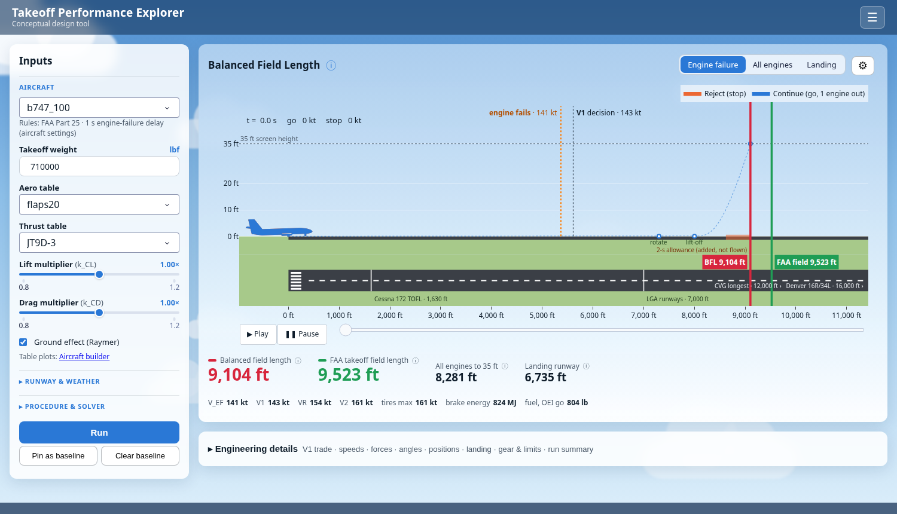

# Takeoff & landing runway estimator

A conceptual-design tool that answers **how much runway an aircraft design needs**. From
the aircraft's lift and drag tables, thrust, weights and the runway conditions, it
simulates:

* the **balanced field length**: an engine fails at the worst moment, and continuing or
  stopping need the same runway (FAA Part 25, or MIL-STD-3013 for military aircraft);
* the **all-engines takeoff** and the **takeoff field length** the rules require;
* the **landing** from 50 ft to a stop and the **landing runway** the rules require;
* the speeds (V1/V_CEF, VR, V_LOF, V2, approach, touchdown), tire speed, brake energy
  and fuel used.

The result to design to is **runway required = max(takeoff field length, landing runway
required)**. A web app (simulator with animations, trade-study maps, aircraft builder)
and a Python API give the same numbers. A **gust analysis** simulates hundreds of
takeoffs and landings in random turbulence (a stochastic differential equation per run)
and answers how much extra runway covers 95 % or 99 % of gusty days. An **uncertainty**
analysis does the same for lift, drag and thrust tables known only to within a stated
percentage, and shows which table's uncertainty matters most.



## Quick start

```bash
pip install -e ".[test]"       # Python 3.11+
python -m app                  # the app at http://127.0.0.1:8050
```

In the app: pick an aircraft and press **Run**. The ☰ menu has the **Trade study**, the
**Gust** and **Uncertainty analysis** pages, the **Aircraft builder**, the aircraft
validation pages, and the documentation: **About** (what it answers, the data it needs,
Python use, Q&A), **Assumptions** (the model, the rules, the limits) and **Methods** (the
numerics and their verification). The same pages are the markdown files in `docs/`.

From a script (build the aircraft in the app first, or use one of the examples):

```python
from bfl import analyze, load_config, trade_study

a = analyze("b747_100", weight_lbf=650_000, temperature_F=95, elevation_ft=5000)
print(a.summary())
a.runway_required_ft, a.governed_by          # e.g. 9988.0, "takeoff"

df = trade_study(load_config("b747_100"),
                 {"weight_lbf": [600e3, 650e3, 700e3], "temperature_F": [30, 59, 90]})
```

Templates: `scripts/analyze_example.py`, `scripts/trade_study_example.py`. Details:
[docs/about/python.md](docs/about/python.md).

## Accuracy

* **Boeing 747-100** (real data): takeoff field length within −5.5 % to +4.4 % of
  Boeing's chart, 500,000–705,000 lb, sea level.
* **Lockheed SR-71A** (real lift and thrust, estimated drag): rotation and lift-off speeds
  within about 4 kt of YF-12 flight test.
* Numerics: the solver is converged to fractions of a foot; every method is checked
  against exact solutions and scipy (Methods › Verification).

The input data set the real accuracy, especially drag and the spoiler, engine-out and
landing-flap increments. Thrust tables are sea-level (not lapsed with altitude). The
full list: [docs/assumptions/limits.md](docs/assumptions/limits.md).

## Aircraft

| folder | data | rules |
|---|---|---|
| `aircraft/b747_100` | Boeing 747-100 (JT9D-3), digitized from NASA CR-114494 and Boeing's airport-planning document; flaps 10/20; Raymer ground effect | Part 25 |
| `aircraft/sr71` | Lockheed SR-71A from the declassified flight manual (2-D thrust table, drag chute); drag estimated | MIL-STD-3013 |

Each folder's README lists the sources of every number. New aircraft: the app's
**Aircraft builder**, or a folder with an `aircraft.yaml` and CSV tables
([docs/about/aircraft_data.md](docs/about/aircraft_data.md)). Aircraft can live anywhere:
`analyze` and `load_config` take a folder, an `aircraft.yaml` path, or a builder `.zip`.

## Repository

| path | contents |
|---|---|
| `src/bfl/` | the solver: `analysis` (one-call API), `bfl` (takeoff), `landing`, `trade` (trade studies), `gusts` (gust analysis), `sde` (stochastic methods), `uncertainty` (data uncertainty), `config` (inputs and validation), physics (`atmosphere`, `aero`, `propulsion`, `dynamics`, `model`, `takeoff`, `phases`), numerics (`integrators`, `rootfind`, `optimize`, `tables`), `results`, `validation`, `plotting` |
| `app/` | the Dash app; it calls only the public `bfl` API. `reference_aircraft.yaml` (tire-speed references, **placeholder values**) and `reference_runways.yaml` are editable |
| `aircraft/` | the aircraft (yaml + CSV + README with sources) |
| `docs/` | the documentation the app shows: `about/`, `assumptions/`, `methods/` |
| `scripts/` | examples, the 747 validation script and the verification figures |
| `tools/` | table generators for the two aircraft; `make_aircraft_field_docs.py` |
| `tests/` | `python -m pytest` (~35 s); the validation tests also refresh the app's aircraft pages |

## Open items

* MIL-STD-3013**B** text not yet checked: the go branch ends at 50 ft (expected), and the
  landing approach speed (1.2 V_S) and field factor (1.0) are assumptions.
* Tire-speed reference values in `app/reference_aircraft.yaml` are placeholders.
